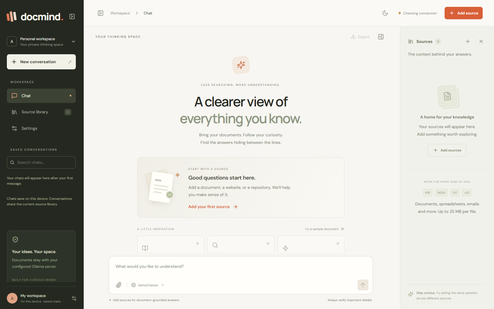
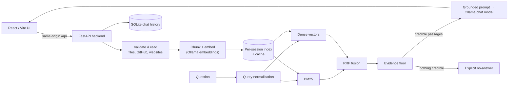

# DocMind AI

**Privacy-preserving document intelligence with hybrid Retrieval-Augmented Generation (RAG), running locally.**

DocMind AI answers questions about your own documents, grounded in what those documents
actually say, with numbered citations back to the source passages. Embedding, retrieval and
generation run on your machine through [Ollama](https://ollama.com), so your files do not
have to leave your device.



## Key features

- **Hybrid retrieval.** BM25 keyword search and dense vector search are fused with
  Reciprocal Rank Fusion (k = 60), so exact terms (names, numbers, codes) and paraphrases
  are both found.
- **Evidence-floor abstention.** A weak vector match is kept only if BM25 also finds a
  keyword hit. When nothing credible remains, DocMind answers "I could not find this
  information in the documents" instead of guessing.
- **Query normalization.** Porter stemming, hyphen splitting (`30-day` → `30 day`),
  number words (`thirty` → `30`), English and Hinglish filler removal (`batao`, `kya`, `hai`),
  and curated synonyms for short keyword queries.
- **Many sources.** 25 file types (PDF, Word, Excel, PowerPoint, CSV, JSON, Markdown, HTML,
  email, EPUB, notebooks and more), public GitHub repositories and public HTTPS websites.
- **Grounded, cited answers.** Answers cite numbered passages; you can open each passage
  from the answer.
- **Prompt-injection hardening.** Retrieved text is quoted as data. Sentences that try to
  instruct the model ("ignore previous instructions…") are withheld from the prompt.
- **Saved conversations.** Chats are stored locally in SQLite, with search, rename and
  Word (.docx) export.
- **Runs on modest hardware.** Index caching, adaptive embedding batches and an Eco Mode
  that trims context and answer length.

## Architecture



| Path | Contents |
|---|---|
| `backend/app.py` | FastAPI app assembly: middleware, routers, built frontend |
| `backend/routes/` | HTTP endpoints: session and settings, sources, conversations, chat |
| `backend/workspace.py` | In-memory workspaces, conversation state and background chat naming |
| `backend/sources.py` | Source lifecycle: reading uploads, indexing, replacing and removing |
| `backend/security.py` | Request boundary: origin check, client header, body size limit |
| `backend/history.py` | SQLite conversation storage and search |
| `utils/llama_index/` | Ingestion, chunking, embeddings, index cache, query normalization, hybrid retrieval |
| `utils/ollama.py` | Model clients, grounded prompt building, streaming |
| `utils/helpers.py` | Upload validation, website fetching (SSRF-safe), GitHub cloning |
| `utils/document_readers.py` | Readers for Office, email, EPUB, spreadsheets and other formats |
| `frontend/src/state/` | `WorkspaceProvider` / `useWorkspace()` state, theme and layout hooks |
| `frontend/src/components/` | Sidebar, chat, library, settings and dialog components |
| `frontend/src/styles/` | Stylesheets, imported in cascade order by `style.css` |
| `eval_harness.py`, `eval_quality.py` | Reproducible evaluation (mock and live) |

More detail: [pipeline](docs/pipeline.md) · [React workspace](docs/react-workspace.md) ·
[security](docs/security.md) · [answer quality](docs/answer-quality.md).

## Quick start

Requirements: Python 3.13, Node.js 22, Git and [Ollama](https://ollama.com).
LibreOffice (Writer and Impress) is optional and enables legacy `.doc`/`.ppt` files.

```bash
ollama pull llama3:latest
ollama pull nomic-embed-text:latest

python -m pip install pipenv
pipenv sync --dev

cd frontend
npm ci
npm run build
cd ..

pipenv run python -m uvicorn backend.app:app --host 127.0.0.1 --port 8765
```

Open <http://127.0.0.1:8765>, add a source and ask a question. On Windows you can run
`./run.ps1` after setup. Run a single API worker: document indexes are kept in memory.

### Docker

```bash
docker compose up --build -d --wait
```

The container serves the app on <http://localhost:8765> (bound to localhost only) and
reaches Ollama on the host at `http://host.docker.internal:11434`. It runs as a non-root
user with a read-only filesystem. See [docs/setup.md](docs/setup.md) for configuration
(`DOCMIND_OLLAMA_ENDPOINT`, `DOCMIND_DATA_DIR`, `DOCMIND_PORT`).

## Usage

1. **Add sources:** upload up to 10 files (25 MB each, 100 MB total), import a public
   GitHub repository (`owner/repo`), paste public HTTPS URLs, or try the sample document.
2. **Ask questions:** answers stream in with numbered citations. Select a citation to see
   the passage it came from.
3. **Ask without documents:** if nothing relevant is found, you can ask the model directly.
4. **Settings:** choose the provider (Ollama, or any OpenAI-compatible server such as
   LM Studio or TabbyAPI), the chat and embedding models, answer style, Top K, chunk size,
   similarity cutoff and Eco Mode.

See [docs/usage.md](docs/usage.md) and [docs/troubleshooting.md](docs/troubleshooting.md).

## Testing and evaluation

```bash
pipenv run python -m unittest discover -s tests          # backend tests
pipenv run ruff check . --select E9,F63,F7,F82            # static checks
pipenv run python eval_harness.py --mock --out output/evaluation-mock
pipenv run python eval_harness.py --suite retrieval --out output/evaluation-retrieval-ablation
pipenv run python eval_harness.py --chat-model llama3:latest --out output/evaluation-live
```

Frontend: `cd frontend && npm run lint && npm test` (ESLint and Vitest unit tests).
Browser tests (Playwright) run against a started server: `npx playwright test`.

The harness reports passed, failed and skipped checks separately. Mock mode uses hash
embeddings and never measures answer quality; live mode requires the named models.
The retrieval suite compares four configurations on the same index:

| Configuration (nomic-embed-text, 11 answerable / 6 unanswerable queries) | Hit rate | Correct rejection |
|---|---:|---:|
| Vector only | 11/11 | 0/6 |
| BM25 only | 11/11 | 6/6 |
| Hybrid RRF, no evidence floor | 11/11 | 0/6 |
| **Full DocMind (hybrid + evidence floor)** | **11/11** | **6/6** |

The fixture corpus is small, so these numbers show the abstention behavior, not general
retrieval accuracy. Live answer results by chat model are in
[docs/answer-quality.md](docs/answer-quality.md).

## Security and privacy

- Uploads: extension allow-list, safe filenames, size limits (also enforced on chunked
  requests without a `Content-Length`), and archive-expansion limits for Office/EPUB files.
- Websites: HTTPS only. Private, loopback and link-local addresses are blocked, the
  resolved IP is pinned for the request, and redirects and response sizes are limited.
- GitHub: input is normalized to `owner/repo` and cloned shallowly with hooks disabled.
- API: same-origin checks, a required client header on state-changing requests, trusted
  hosts limited to `localhost`/`127.0.0.1`, and HttpOnly SameSite cookies.
- Notebooks, macros and spreadsheet formulas are never executed.

Details and reporting: [docs/security.md](docs/security.md) · [SECURITY.md](SECURITY.md).

## Limitations

- Indexes live in memory: run one worker, and sources must be re-added after a restart
  (saved conversations persist).
- No OCR for scanned PDFs or images.
- Answer quality depends on the chat model. Small models (for example `qwen2.5:0.5b`)
  often omit citations; verify important answers against the cited passages.
- Designed for local use. Public hosting would need authentication and a different
  session architecture.

## Team

DocMind AI is a group project by B.Tech Data Science students.

| Name | GitHub |
|---|---|
| Amaan Shaikh | [@Amaann190](https://github.com/Amaann190) |
| Saniya Shaikh | [@shsaniya04](https://github.com/shsaniya04) |
| Kaushar Halani | |
| Aditya Singh | |

## Contributing

1. Clone the repository: `git clone https://github.com/Amaann190/DocMind-AI.git`
2. Create a branch: `git checkout -b your-feature`
3. Commit using the email linked to your GitHub account, so the commit is credited to you.
4. Run the tests above, then push the branch and open a pull request into `main`.

See [docs/contributing.md](docs/contributing.md).

## License

Released under the [GNU General Public License v3.0](LICENSE).
