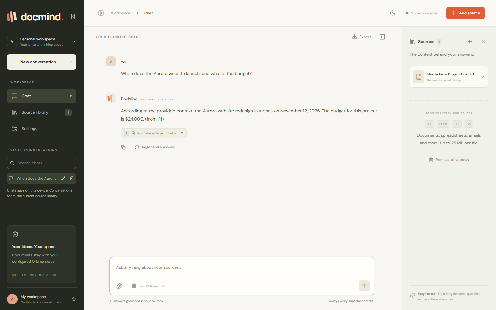
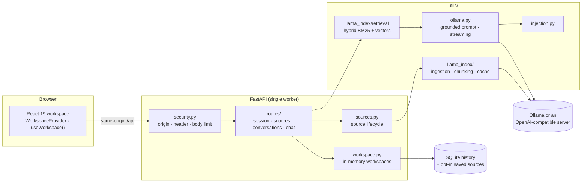
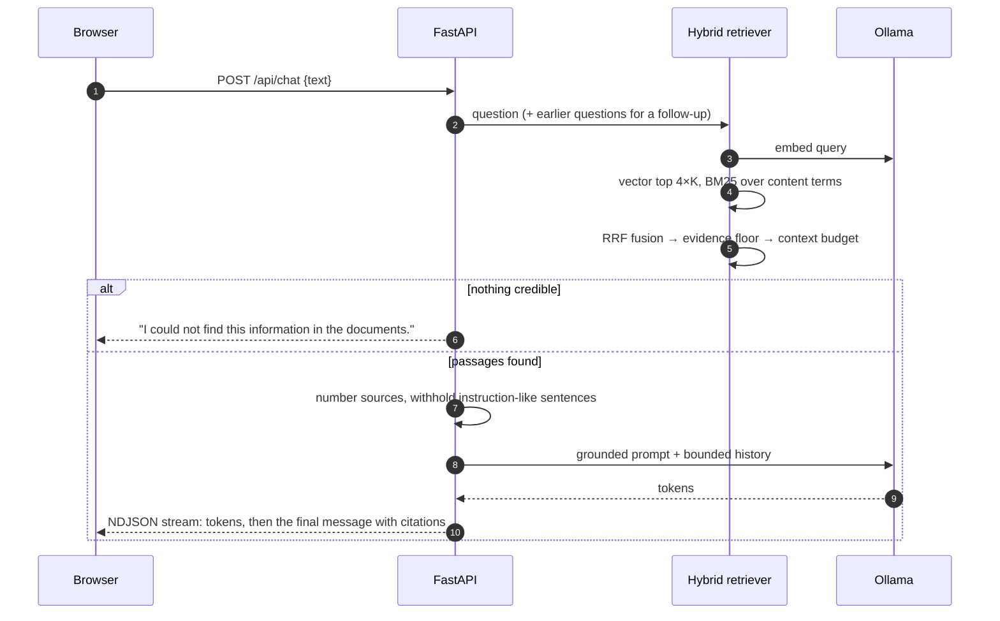

<div align="center">

# DocMind AI

**Private, grounded answers from your own documents: hybrid retrieval-augmented generation that runs on your machine.**

[](https://github.com/Amaann190/DocMind-AI/actions/workflows/quality.yml)
[](https://github.com/Amaann190/DocMind-AI/actions/workflows/main.yaml)
[](LICENSE)
[](https://www.python.org/)
[](https://nodejs.org/)
[](https://fastapi.tiangolo.com/)
[](https://react.dev/)
[](https://ollama.com/)
[](https://docs.astral.sh/ruff/)
[](https://github.com/microsoft/pyright)

[Quick start](#quick-start) ·
[How it works](#how-it-works) ·
[Benchmarks](#benchmarks) ·
[Configuration](#configuration) ·
[API](#http-api) ·
[Documentation](#documentation)

<picture>
  <source media="(prefers-color-scheme: dark)" srcset="docs/images/answer-dark.png">
  
</picture>

</div>

---

## Table of contents

- [Why DocMind](#why-docmind)
- [Features](#features)
- [Benchmarks](#benchmarks)
- [How it works](#how-it-works)
- [Quick start](#quick-start)
- [Usage](#usage)
- [Configuration](#configuration)
- [Supported sources](#supported-sources)
- [HTTP API](#http-api)
- [Project structure](#project-structure)
- [Development](#development)
- [Testing and quality](#testing-and-quality)
- [Evaluation](#evaluation)
- [Security and privacy](#security-and-privacy)
- [Performance and resource use](#performance-and-resource-use)
- [Troubleshooting](#troubleshooting)
- [Limitations](#limitations)
- [Roadmap](#roadmap)
- [Documentation](#documentation)
- [Contributing](#contributing)
- [Team](#team)
- [Citation](#citation)
- [Acknowledgements](#acknowledgements)
- [License](#license)

---

## Why DocMind

Asking a cloud chatbot about a contract, a policy manual or an internal report means
sending that document to a third party. Running a model locally solves the privacy
problem but creates new ones: plain vector search misses exact codes and numbers,
weakly related passages lead small models to invent answers, and a mix of PDFs,
spreadsheets, emails and websites has to be read safely.

DocMind AI is a self-hosted document assistant built around three ideas:

1. **Find the right passage.** Keyword search (BM25) and semantic vector search are
   fused, so both exact identifiers like `E-219` and paraphrased questions work.
2. **Say "I don't know" when the documents don't say.** An evidence floor discards
   weak matches before generation, so unrelated questions get an explicit
   "I could not find this information in the documents" instead of a guess.
3. **Show the evidence.** Every answer cites numbered passages you can open, and
   the evaluation harness reports measured results, including the failures.

Embedding, retrieval and generation run through [Ollama](https://ollama.com) on
your own hardware by default. OpenAI-compatible servers (LM Studio, TabbyAPI) and an
optional [R2R](https://github.com/SciPhi-AI/R2R) backend are supported.

## Features

<table>
<tr>
<td width="50%" valign="top">

**Retrieval**
- Hybrid BM25 + dense retrieval fused with Reciprocal Rank Fusion (k = 60)
- Evidence floor and "minimum should match" keyword evidence for abstention
- Query normalization: Porter stemming, hyphen splitting, number words, stopword
  and Hinglish filler removal, curated synonyms and phrases
- Follow-up questions resolved from earlier user turns
- Title-aware, table-aware and code-aware chunking with exact-duplicate removal

</td>
<td width="50%" valign="top">

**Answers**
- Grounded prompt that answers only from numbered sources and cites them
- Fixed missing-evidence reply when nothing credible is retrieved
- Instruction-like text inside documents is withheld from the model
- Streaming answers with stop and regenerate
- Six answer styles, temperature and context controls

</td>
</tr>
<tr>
<td valign="top">

**Sources**
- 25 file types, from PDF and Office to email, EPUB and notebooks
- Public GitHub repositories (shallow clone, hooks disabled)
- Public HTTPS websites with SSRF protection
- Per-source retry, replace and remove; a source library with previews

</td>
<td valign="top">

**Workspace**
- Saved conversations with search, rename and Word (`.docx`) export
- Optional "Keep sources after restart"
- Light and dark themes, resizable panels, responsive layout
- Eco Mode for low-power machines
- Docker image with a read-only, non-root container

</td>
</tr>
</table>

## Benchmarks

DocMind ships an evaluation harness that compares four retrieval configurations on the
same index: **vector only**, **BM25 only**, **hybrid without the evidence floor** and
**full DocMind** (hybrid + evidence floor). All numbers below come from committed runs
in [`output/`](output) and can be reproduced with the commands in [Evaluation](#evaluation).

### Public benchmark: BEIR SciFact

300 scientific claims over 5,183 abstracts ([SciFact](https://github.com/allenai/scifact),
via [BEIR](https://github.com/beir-cellar/beir)). It has no unanswerable queries, so it
measures ranking only.

| Configuration | nDCG@10 · `nomic-embed-text` | nDCG@10 · `all-minilm` | Recall@10 · nomic / minilm |
|---|---:|---:|---:|
| Vector only | 0.707 | 0.637 | 83% / 79% |
| BM25 only (evidence-gated) | 0.543 | 0.543 | 61% / 61% |
| Hybrid RRF, no evidence floor | **0.718** | **0.691** | 86% / 82% |
| Full DocMind | **0.718** | 0.645 | 86% / 76% |

### Labelled benchmark: answer *and* abstain

20 documents with deliberate overlaps, 70 answerable queries labelled by type, and 32
off-topic questions written naturally (not filtered for keyword overlap). Embeddings:
`nomic-embed-text`.

| Configuration | Recall@1 | Recall@5 | MRR@5 | Correct rejection |
|---|---:|---:|---:|---:|
| Vector only | 90% | 99% | 0.940 | 0% |
| BM25 only | 80% | 80% | 0.800 | 97% |
| Hybrid RRF, no evidence floor | 93% | 100% | 0.964 | 0% |
| **Full DocMind** | **93%** | **100%** | **0.964** | **75%** |

### End-to-end answers

With `llama3:latest` and `nomic-embed-text:latest`, the live suite passes **81 of 81
checks**, including **34 of 34 answer checks** (exact facts, conflicting sources,
missing evidence, follow-ups, a document prompt-injection case and one question per
supported file format). With the 0.5B-parameter `qwen2.5:0.5b`, 3 of 34 pass, mostly
because it omits citations.

> [!NOTE]
> **Reading these numbers.** Fusion beats each channel alone on both retrieval
> benchmarks, and the evidence floor is what makes rejection possible. The floor (0.5)
> is calibrated for `nomic-embed-text`; with `all-minilm` it also drops relevant
> results. The labelled corpus is synthetic and the answer checks are rule-based. See
> [docs/answer-quality.md](docs/answer-quality.md) for method, per-type results and the
> corrections these benchmarks led to.

## How it works

### Architecture



### Answering a question



### Retrieval pipeline

| Step | What happens | Default |
|---|---|---|
| Chunking | Sentence-aware chunks with overlap; titles prepended; tables verbalized; code fences kept whole | 256 tokens, 32 overlap |
| Query normalization | Number words → digits, hyphen splitting, Porter stemming (once), stopword and filler removal | — |
| Dense retrieval | Cosine similarity over embeddings, wider candidate pool than the answer needs | 4 × Top K, at least 10 |
| Keyword retrieval | BM25+ over stemmed content terms, short queries widened with curated synonyms | — |
| Fusion | Reciprocal Rank Fusion of both ranked lists | k = 60 |
| Evidence floor | A chunk below the floor is kept only if it contains at least half of a question's content terms | cutoff 0.3, floor 0.5 |
| Context budget | Top chunks packed into the model's window, exact duplicates removed | 4,800 characters, Top K = 3 |
| Generation | Numbered sources, cite-as-you-go instructions, fixed missing-evidence reply | temperature 0.4 |

## Quick start

### Prerequisites

| Requirement | Version | Notes |
|---|---|---|
| [Python](https://www.python.org/) | 3.13 | with [Pipenv](https://pipenv.pypa.io/) |
| [Node.js](https://nodejs.org/) | 22 | builds the web UI |
| [Ollama](https://ollama.com/) | recent | serves embeddings and chat |
| [Git](https://git-scm.com/) | any | for GitHub sources |
| [LibreOffice](https://www.libreoffice.org/) | optional | Writer and Impress enable legacy `.doc` and `.ppt` |

### 1. Get the models

```bash
ollama pull llama3:latest
ollama pull nomic-embed-text:latest
```

### 2. Install

```bash
git clone https://github.com/Amaann190/DocMind-AI.git
cd DocMind-AI
python -m pip install pipenv
pipenv sync --dev
```

```bash
cd frontend
npm ci
npm run build
cd ..
```

### 3. Run

```bash
pipenv run python -m uvicorn backend.app:app --host 127.0.0.1 --port 8765
```

Open <http://127.0.0.1:8765>, choose **Add source** (or **Try a sample document**) and ask a question.

> [!TIP]
> On Windows, `./run.ps1` starts the built app and refuses to start if the port is taken
> (`./run.ps1 -Port 8766` to choose another).

### Docker

```bash
docker compose up --build -d --wait
```

The container serves the app on <http://localhost:8765> (bound to `127.0.0.1` only) and
reaches Ollama on the host at `http://host.docker.internal:11434`. It runs as a non-root
user on a read-only filesystem with all capabilities dropped; conversation history lives
in the `docmind-data` volume. Check a deployment with:

```bash
docker compose exec -T docmind python < scripts/check_container.py
```

## Usage

1. **Add sources.** Upload up to 10 files at once, import a public GitHub repository
   (`owner/repo` or its URL), paste up to 5 public HTTPS URLs, or load the sample document.
   Each source shows its status, and you can preview, retry, replace or remove it from
   the source library.
2. **Ask questions.** Answers stream in with citations such as `(from [1])`; select a
   citation chip to read the exact passage, with its page number when the reader provides one.
3. **When nothing is found**, DocMind says so instead of guessing. You can then ask the
   model directly without documents.
4. **Follow up naturally.** Short follow-ups ("and for electronics?", "just give me
   names") are resolved from your earlier questions; earlier answers are never treated as evidence.
5. **Keep your work.** Conversations are saved locally, searchable and exportable to Word.
   Turn on **Keep sources after restart** if you also want sources to survive a restart.

More detail: [docs/usage.md](docs/usage.md).

## Configuration

### Workspace settings

Set in **Settings** in the app (or `PUT /api/settings`). Browser storage keeps your
preferences but never credentials.

| Setting | Default | Range / values | Effect |
|---|---|---|---|
| Provider | `Ollama` | `Ollama`, `OpenAI`, `LM Studio (Local AI)`, `TabbyAPI` | Model server API |
| Endpoint | `http://localhost:11434` | http(s) URL without credentials | Model server address |
| Chat model | `llama3:latest` | any installed model | Generates answers |
| Embedding model | `nomic-embed-text:latest` | any embedding model | Builds the vector index |
| API key | empty | — | For OpenAI-compatible servers; never stored on disk |
| Answer style | `Balanced` | `Balanced`, `Concise`, `Detailed`, `Bulleted`, `Technical`, `Simple` | Tone of answers |
| Creativity (temperature) | `0.4` | 0 – 1.5 | Sampling temperature |
| Sources per answer (Top K) | `3` | 1 – 10 | Passages given to the model |
| Chunk size | `256` | 64 – 8192 tokens | Index granularity |
| Chunk overlap | `32` | 0 – 4096, below chunk size | Context shared between chunks |
| Similarity cutoff | `0.3` | 0 – 1 | Minimum vector score |
| Eco Mode | off | on / off | Smaller batches, budgets and answers |
| Keep sources after restart | off | on / off | Saves sources to the data directory |
| R2R | off | on / off, URL, key | Ingest and retrieve on an R2R server |

Changing the provider, endpoint, embedding model, chunking or R2R settings rebuilds the
index, so existing sources are cleared.

### Environment variables

| Variable | Default | Purpose |
|---|---|---|
| `DOCMIND_OLLAMA_ENDPOINT` | `http://localhost:11434` | Default model server endpoint |
| `DOCMIND_DATA_DIR` | `./data` | Conversation history (`react-history.sqlite3`) and opt-in saved sources |
| `DOCMIND_LIBREOFFICE` | auto-detected | Path to `soffice` for legacy Office files |
| `DOCMIND_PORT` | `8765` | Host port in Docker Compose |
| `DOCMIND_CPUS` | `4` | CPU limit in Docker Compose |

### Limits

| Limit | Value |
|---|---|
| Files per upload | 10 |
| Size per file / per workspace | 25 MB / 100 MB (also enforced on chunked requests) |
| Websites per import | 5, HTTPS only, at most 3 redirects, 5 MB per page |
| GitHub clone timeout | 120 seconds |
| Documents / text per index | 300 documents, 4 MiB of extracted text |
| Workspaces per server | 64; idle workspaces expire after 8 hours |

## Supported sources

| Category | Extensions |
|---|---|
| Documents | `.pdf` `.docx` `.doc` `.odt` `.rtf` `.txt` `.md` `.markdown` |
| Presentations | `.pptx` `.ppt` |
| Spreadsheets and data | `.xlsx` `.xls` `.csv` `.tsv` `.json` `.jsonl` `.xml` |
| Web | `.html` `.htm` `.mhtml` |
| Email | `.eml` `.msg` `.mbox` |
| Books and notebooks | `.epub` `.ipynb` |
| Remote | public GitHub repositories, public HTTPS websites |

Spreadsheet formulas are read with their saved results and never recalculated; macros
and notebooks are never executed. Scanned, image-only PDFs need OCR first.

## HTTP API

The web UI talks to a same-origin JSON API. Workspaces are identified by an HttpOnly,
`SameSite=Strict` cookie, and every request that changes state must send
`X-DocMind-Client: react`. Most endpoints return the full workspace snapshot.

| Method | Path | Purpose |
|---|---|---|
| `GET` | `/api/health` | Liveness check |
| `POST` | `/api/session` | Open or resume a workspace (sets the cookie) |
| `GET` | `/api/state` | Current workspace snapshot |
| `DELETE` | `/api/session` | Reset the workspace: sources, history and settings |
| `PUT` | `/api/settings` | Update settings |
| `GET` | `/api/models` | List chat and embedding models on the configured server |
| `POST` | `/api/upload` | Upload files (`multipart/form-data`, field `files`) |
| `POST` | `/api/import` | Import `{"kind": "website" \| "github" \| "sample", "value": "..."}` |
| `DELETE` | `/api/sources` | Remove all sources |
| `DELETE` | `/api/sources/{id}` | Remove one source |
| `POST` | `/api/sources/{id}/retry` | Re-read or re-index one source |
| `PUT` | `/api/sources/{id}` | Replace a file source |
| `POST` | `/api/chat` | Ask `{"text", "without_documents", "regenerate"}`; streams NDJSON events |
| `POST` | `/api/chat/stop` | Stop the current answer |
| `DELETE` | `/api/chat` | Clear the current conversation |
| `GET` | `/api/conversations?q=` | List or search saved conversations |
| `POST` | `/api/conversations` | Start a new conversation |
| `PUT` | `/api/conversations/{id}` | Rename `{"title": "..."}` |
| `POST` | `/api/conversations/{id}/open` | Switch to a conversation |
| `DELETE` | `/api/conversations/{id}` | Delete a conversation |
| `GET` | `/api/export` | Download the conversation as `.docx` |

<details>
<summary>Example: ask a question from the command line</summary>

```bash
# Open a workspace and keep its cookie
curl -s -c jar -H "X-DocMind-Client: react" -X POST http://127.0.0.1:8765/api/session > /dev/null

# Load the sample document
curl -s -b jar -H "X-DocMind-Client: react" -H "Content-Type: application/json" \
     -d '{"kind": "sample"}' http://127.0.0.1:8765/api/import > /dev/null

# Ask; the answer streams as newline-delimited JSON events
curl -N -b jar -H "X-DocMind-Client: react" -H "Content-Type: application/json" \
     -d '{"text": "When does the Aurora website launch?"}' http://127.0.0.1:8765/api/chat
```

Stream events: `{"type": "token", "text": ...}` while generating, then `{"type": "done", "message": {...}}`
with the final answer and its cited passages (or `"error"` / `"warning"`).

</details>

## Project structure

```text
DocMind-AI/
├── backend/                   FastAPI application
│   ├── app.py                 app assembly: middleware, routers, built UI
│   ├── routes/                session, sources, conversations, chat endpoints
│   ├── workspace.py           in-memory workspaces and conversation state
│   ├── sources.py             source lifecycle and background restore
│   ├── source_store.py        opt-in saved sources
│   ├── security.py            request boundary
│   ├── settings.py            validated workspace settings
│   └── history.py             SQLite conversation storage and search
├── utils/
│   ├── llama_index/           ingestion, chunking, embeddings, cache, query, retrieval
│   ├── ollama.py              model clients, grounded prompts, streaming
│   ├── injection.py           instruction-like text filter
│   ├── document_readers.py    Office, email, EPUB, spreadsheet and other readers
│   ├── helpers.py             upload validation, SSRF-safe fetching, GitHub cloning
│   └── r2r.py                 optional R2R backend client
├── frontend/                  React 19 + Vite workspace
│   └── src/
│       ├── state/             WorkspaceProvider, useWorkspace(), theme and layout hooks
│       ├── components/        sidebar, chat, library, settings and dialogs
│       ├── lib/               stream parsing
│       └── styles/            stylesheets in cascade order
├── evaluation/                evaluation suites, labelled and public benchmarks
├── eval_harness.py            evaluation command-line entry point
├── tests/                     Python unit and API tests
├── docs/                      setup, usage, pipeline, security, answer quality
├── output/                    recorded evaluation runs
├── docker-compose.yml         hardened local container
├── pyproject.toml             Ruff, pyright and coverage configuration
└── Pipfile                    Python dependencies (Pipenv)
```

## Development

Run the API and the Vite dev server side by side for hot reload:

```bash
pipenv run python -m uvicorn backend.app:app --host 127.0.0.1 --port 8765 --reload
```

```bash
cd frontend
npm run dev    # http://localhost:5173, proxies /api to port 8765
```

Rebuild the UI (`npm run build`) to serve changes from the API port. Keep one API
worker: indexes live in process memory. Conventions for contributors and coding agents
are in [AGENTS.md](AGENTS.md).

## Testing and quality

```bash
pipenv run python -m unittest discover -s tests          # 188 backend tests
pipenv run ruff check .                                   # lint
pipenv run pyright                                        # type check (basic mode)
pipenv run coverage run -m unittest discover -s tests && pipenv run coverage report
```

```bash
cd frontend
npm run lint                  # ESLint
npm test                      # Vitest unit tests
npx playwright test           # browser tests against a running server
```

Pyright and coverage are installed with `pipenv run pip install pyright coverage`.
Set `DOCMIND_LIVE=1` to include the Playwright test that uploads a file and asks a real
model.

Every pull request runs:

| Workflow | Checks |
|---|---|
| **Quality** | ESLint, Vitest and production build; backend tests and mock evaluation under coverage (fails below 85%); pyright; Ruff; read-only container startup check |
| **Docker Build** | Multi-stage image build |

## Evaluation

The harness separates structural checks from model-dependent answers and reports
passed, failed and skipped checks separately. Mock mode uses deterministic hash
embeddings and never measures answer quality.

```bash
# Structural checks, no model needed
pipenv run python eval_harness.py --mock --out output/evaluation-mock

# Retrieval ablation on the fixture corpus
pipenv run python eval_harness.py --suite retrieval --out output/evaluation-retrieval-ablation

# Labelled benchmark (20 documents)
pipenv run python eval_harness.py --suite benchmark --out output/evaluation-benchmark

# Public benchmark (downloads BEIR SciFact, SHA-256 pinned)
pipenv run python eval_harness.py --suite public --model nomic-embed-text:latest --out output/evaluation-public-nomic-embed-text

# Everything, with live answers from a chat model
pipenv run python eval_harness.py --chat-model llama3:latest --out output/evaluation-live
```

| Suite | Covers |
|---|---|
| `ingestion` | file types, exclusions, chunking, dedup, titles, cache |
| `retrieval` | four-way ablation, synonyms, hyphens, Hinglish, stemming, rejection |
| `generation` | prompt guards, fallback, history, and 34 live answer checks |
| `performance` | cache hits, retrieval latency, Eco Mode budgets, OOM back-off |
| `robustness` | malformed input, SSRF and repository validation, binary exclusion |
| `architecture` | settings, export, import boundaries |
| `benchmark` | labelled 20-document benchmark (on request) |
| `public` | BEIR SciFact ranking benchmark (on request) |

## Security and privacy

DocMind is designed for **local, single-user** use.

- **Data stays local by default.** Documents go only to the model server you configure.
  Conversations are stored in SQLite under `DOCMIND_DATA_DIR`. Sources are temporary
  unless you enable **Keep sources after restart**, which writes their text and uploaded
  files unencrypted to the data directory; turning it off deletes them.
- **Credentials** are kept in server memory only: never in SQLite, saved sources or browser storage.
- **Uploads:** extension allow-list, safe filenames, size limits (also on chunked
  requests) and archive-expansion limits for Office and EPUB packages.
- **Websites:** HTTPS only; private, loopback and link-local addresses blocked; the
  resolved address is pinned for the request; redirects and response size are limited.
- **GitHub:** input normalized to `owner/repo`; shallow clone with hooks and local
  file protocol disabled.
- **API boundary:** trusted hosts limited to `localhost` and `127.0.0.1`, same-origin
  check, a required client header on state-changing requests, HttpOnly SameSite cookies.
- **Prompt injection:** sentences in retrieved documents that address the model
  ("ignore previous instructions", role markers, "answer X instead") are withheld from
  the prompt. This is a pattern filter, not a guarantee.

Report vulnerabilities as described in [SECURITY.md](SECURITY.md). Details:
[docs/security.md](docs/security.md).

## Performance and resource use

DocMind runs on laptops without a GPU; Ollama handles acceleration when one is present.

| | Normal | Eco Mode |
|---|---:|---:|
| Embedding batch size | 16 | 4 |
| Retrieved context | 4,800 chars | 3,200 chars |
| Top K | as set | at most 3 |
| Answer length | 512 tokens | 256 tokens |
| Conversation history in prompts | 500 tokens | 300 tokens |

Built indexes are cached per workspace and keyed by content and embedding settings, so
re-adding the same documents skips re-embedding. Embedding batches shrink automatically
after a GPU out-of-memory error. For reference, indexing all 5,183 SciFact abstracts took
about 7 minutes with `nomic-embed-text` and 2 minutes with `all-minilm` on the
development laptop.

## Troubleshooting

| Symptom | Fix |
|---|---|
| "Model offline" in the top bar | Start Ollama (`ollama serve`) and check the endpoint in Settings |
| Embedding or chat model not listed | `ollama pull <model>`; embedding models must declare the embedding capability |
| "No readable text found" for a PDF | The file is probably scanned; run OCR first |
| `.doc` or `.ppt` files fail | Install LibreOffice Writer/Impress or set `DOCMIND_LIBREOFFICE` |
| "A task is still running" | Wait for indexing or the current answer, or press **Stop** |
| Answers ignore your documents | Check sources show **Ready**; small models (under 1B) often skip citations |
| Port 8765 already in use | `./run.ps1 -Port 8766`, or `--port` for uvicorn, or `DOCMIND_PORT` for Docker |

More: [docs/troubleshooting.md](docs/troubleshooting.md).

## Limitations

- **Single worker.** Workspaces and indexes live in one process, so the API must run
  with one worker; it is not built for multiple users or public hosting.
- **Evidence floor calibration.** The 0.5 floor suits `nomic-embed-text`; other
  embedding models may need a different value.
- **Prompt-injection filtering is pattern-based** and can be evaded by rewording.
- **No OCR** for scanned documents or images.
- **Model-dependent answers.** Small chat models often omit citations; verify important
  answers against the cited passages.
- **Benchmarks** use one synthetic corpus, one public dataset and one chat model.

## Roadmap

- [x] Hybrid retrieval with evidence-floor abstention
- [x] Labelled and public (BEIR SciFact) retrieval benchmarks
- [x] Opt-in source persistence across restarts
- [ ] Per-model evidence-floor calibration
- [ ] Shared index store for multiple workers
- [ ] OCR for scanned PDFs and images
- [ ] Classifier-based prompt-injection detection
- [ ] More public benchmarks and chat models

## Documentation

| Guide | Contents |
|---|---|
| [Setup](docs/setup.md) | Installation, configuration and Docker |
| [Usage](docs/usage.md) | Working with sources and conversations |
| [Pipeline](docs/pipeline.md) | Architecture and data flow |
| [React workspace](docs/react-workspace.md) | Frontend design |
| [Answer quality](docs/answer-quality.md) | Evaluation method and all recorded results |
| [Security](docs/security.md) | Threat model and controls |
| [Runtime validation](docs/runtime-validation.md) | Verifying a deployment |
| [Troubleshooting](docs/troubleshooting.md) | Common problems |
| [Contributing](docs/contributing.md) | Development workflow |

## Contributing

Contributions are welcome.

1. Fork or clone the repository and create a branch: `git checkout -b feature/your-change`.
2. Make your change with tests. Validation, persistence, ingestion-safety and
   session-isolation changes always need tests.
3. Run the checks in [Testing and quality](#testing-and-quality).
4. Commit with the email linked to your GitHub account so the commit is credited to you.
5. Open a pull request into `main` and describe what changed and how you verified it.

See [docs/contributing.md](docs/contributing.md) and [AGENTS.md](AGENTS.md).

## Team

DocMind AI is a group project by B.Tech Data Science students.

| Name | GitHub |
|---|---|
| Amaan Shaikh | [@Amaann190](https://github.com/Amaann190) |
| Saniya Shaikh | [@shsaniya04](https://github.com/shsaniya04) |
| Kaushar Halani | |
| Aditya Singh | |

## Citation

If you use DocMind AI in academic work, please cite the repository:

```bibtex
@software{docmind_ai_2026,
  title  = {DocMind AI: Privacy-Preserving Hybrid Retrieval-Augmented Generation for Local Document Intelligence},
  author = {Shaikh, Amaan and Shaikh, Saniya and Halani, Kaushar and Singh, Aditya},
  year   = {2026},
  url    = {https://github.com/Amaann190/DocMind-AI}
}
```

## Acknowledgements

DocMind builds on [Ollama](https://ollama.com), [LlamaIndex](https://www.llamaindex.ai/),
[rank-bm25](https://github.com/dorianbrown/rank_bm25), [NLTK](https://www.nltk.org/),
[FastAPI](https://fastapi.tiangolo.com/), [React](https://react.dev/),
[Vite](https://vite.dev/) and [Lucide](https://lucide.dev/). The public benchmark uses
[SciFact](https://github.com/allenai/scifact) (Wadden et al., 2020) as distributed by
[BEIR](https://github.com/beir-cellar/beir) (Thakur et al., 2021). Reciprocal Rank
Fusion follows Cormack, Clarke and Büttcher (SIGIR 2009).

## License

DocMind AI is free software, released under the [GNU General Public License v3.0](LICENSE).
